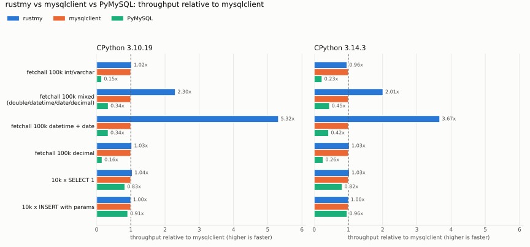

# Benchmarks

## Running

`spike.py` compares rustmy, mysqlclient and PyMySQL on the same server, in
the same process run. It reports the best of N attempts per scenario and the
speedup against mysqlclient; absolute times depend on the machine and are not
the point.

```sh
docker compose up -d --wait mysql
# mysqlclient compiles against libmysqlclient (macOS: brew install mysql-client pkg-config)
PKG_CONFIG_PATH=/opt/homebrew/opt/mysql-client/lib/pkgconfig uv sync --group bench
uv run --no-sync maturin develop --uv --release   # never benchmark a debug build
uv run --no-sync python benches/spike.py --repeat 5 --json benches/results/phase0-py310.json
# charts and the tables below are generated from the JSON files:
uv run --no-sync python benches/report.py benches/results/phase0-*.json
```

Fairness rules the script enforces: all drivers use `autocommit=True`, plain
TCP (mysqlclient would otherwise negotiate TLS, which rustmy does not support
yet) and the same queries against the same tables.

## Phase 0 results (2026-11-13)

Go/no-go criteria from the plan: not slower than mysqlclient on int/varchar,
and at least 1.3x faster on the mixed workload.

Speedup = mysqlclient time / rustmy time; best of 5 runs, MySQL 8.4 in Docker on
the same machine, rustmy built per Python version (not abi3).

<!-- results:start -->
<picture>
  <source media="(prefers-color-scheme: dark)" srcset="results/phase0-dark.svg">
  
</picture>

**CPython 3.10.19** · 8.4.13 · Darwin arm64 · rustmy 0.0.0, mysqlclient 2.3.1, PyMySQL 2.2.8 · best of 5 · 2026-11-13T21:29:06+00:00

| Scenario | rustmy | mysqlclient | PyMySQL | rustmy vs mysqlclient | rustmy vs PyMySQL |
|---|--:|--:|--:|--:|--:|
| fetchall 100k int/varchar | **34.9 ms** | 35.6 ms | 239.7 ms | 1.02x | 6.88x |
| fetchall 100k mixed (double/datetime/date/decimal) | **62.1 ms** | 142.8 ms | 416.8 ms | 2.30x | 6.72x |
| fetchall 100k datetime + date | **18.1 ms** | 96.3 ms | 283.2 ms | 5.32x | 15.64x |
| fetchall 100k decimal | **17.7 ms** | 18.3 ms | 112.2 ms | 1.03x | 6.33x |
| 10k x SELECT 1 | **646.0 ms** | 674.3 ms | 813.7 ms | 1.04x | 1.26x |
| 10k x INSERT with params | **1211.8 ms** | 1213.1 ms | 1328.9 ms | 1.00x | 1.10x |
| executemany 10k rows ¹ | 1220.6 ms | **30.0 ms** | 31.2 ms | 0.02x | 0.03x |

**CPython 3.14.3** · 8.4.13 · Darwin arm64 · rustmy 0.0.0, mysqlclient 2.3.1, PyMySQL 2.2.8 · best of 5 · 2026-11-13T21:29:54+00:00

| Scenario | rustmy | mysqlclient | PyMySQL | rustmy vs mysqlclient | rustmy vs PyMySQL |
|---|--:|--:|--:|--:|--:|
| fetchall 100k int/varchar | 37.0 ms | **35.5 ms** | 153.9 ms | 0.96x | 4.16x |
| fetchall 100k mixed (double/datetime/date/decimal) | **66.0 ms** | 132.8 ms | 296.2 ms | 2.01x | 4.49x |
| fetchall 100k datetime + date | **22.2 ms** | 81.6 ms | 192.6 ms | 3.67x | 8.66x |
| fetchall 100k decimal | **21.5 ms** | 22.1 ms | 83.5 ms | 1.03x | 3.89x |
| 10k x SELECT 1 | **626.5 ms** | 645.5 ms | 786.5 ms | 1.03x | 1.26x |
| 10k x INSERT with params | **1225.3 ms** | 1231.1 ms | 1278.0 ms | 1.00x | 1.04x |
| executemany 10k rows ¹ | 1220.9 ms | 28.4 ms | **28.3 ms** | 0.02x | 0.02x |

Times per driver; the fastest is in bold. Ratios above 1 mean rustmy is faster.
¹ Not comparable yet: rustmy runs one INSERT per row, mysqlclient and PyMySQL batch them into multi-row INSERTs (Phase 2). Left out of the chart.
<!-- results:end -->

PyMySQL is 2–7x slower than mysqlclient on every fetch scenario.

**Decision: both criteria are met; the project continues.**

Reading the numbers:

- Temporal types are where rustmy wins: mysqlclient calls a Python function
  per `date`/`datetime` cell, rustmy builds them directly through the
  `datetime` C API.
- int/varchar and `DECIMAL` are at parity, as predicted: object creation
  dominates in both drivers (`Decimal` is built by calling the Python class
  in both). Repeated runs land between 0.96x and 1.05x for int/varchar,
  i.e. within noise. There is room to optimise the row loop itself.
- Small queries and single INSERTs are bound by the network round trip
  (here through Docker's VM). Results over a real network will be closer to
  1.0x; a Unix socket would show more of the client-side difference.
- `executemany` is not comparable yet: rustmy runs one INSERT per row while
  mysqlclient rewrites it into multi-row INSERTs. Phase 2 implements the
  rewrite.

### abi3 vs per-version builds

Same machine, CPython 3.14:

| Scenario | per-version | abi3 |
|---|---|---|
| fetchall int/varchar | 1.05x | 0.98x |
| fetchall mixed | 2.02x | 1.60x |
| fetchall datetime + date | 3.7x | 2.2x |

The limited API has no `datetime` C API, so abi3 builds create temporal
objects through Python calls and lose most of rustmy's advantage. **Wheels
are built per Python version** (cp310–cp315 plus free-threaded cp314t and
cp315t).
