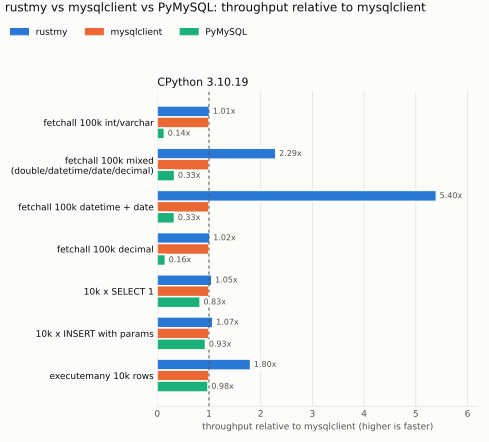
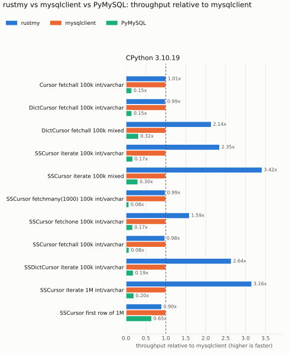
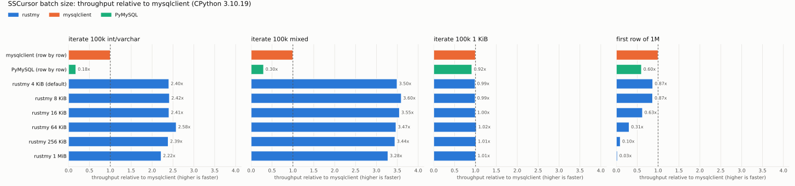
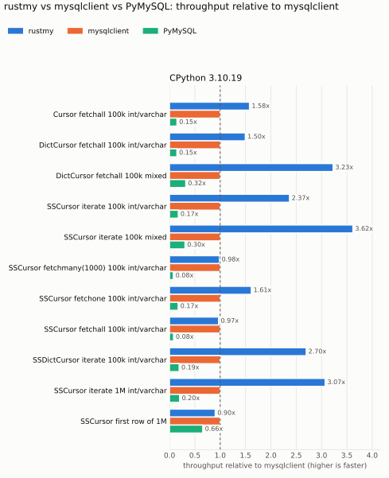
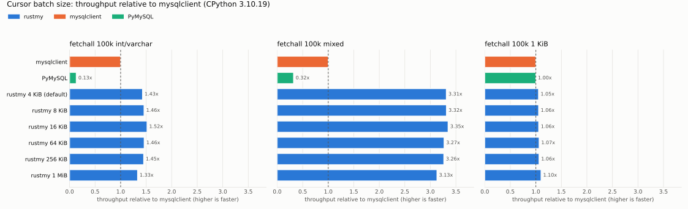
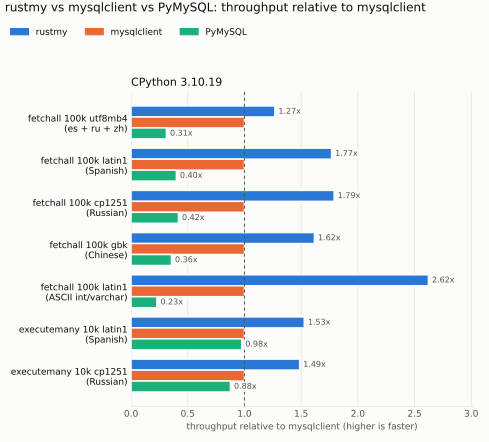
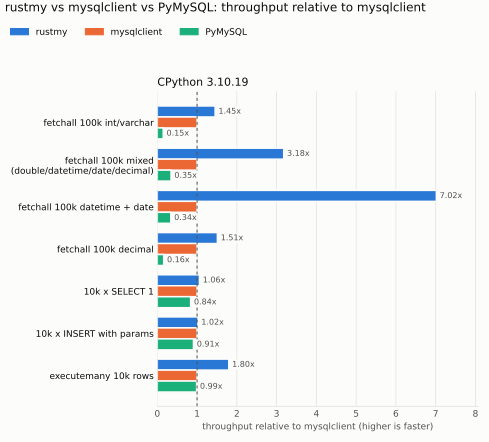
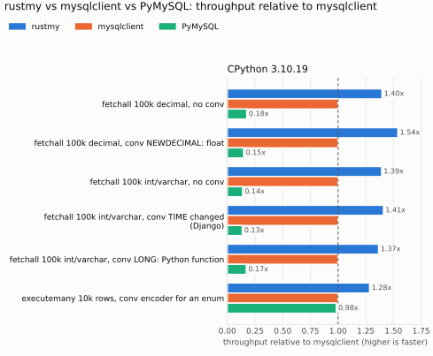
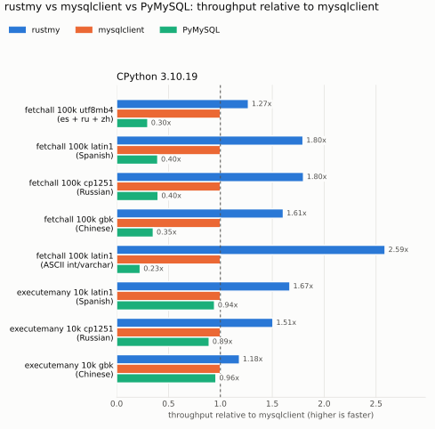

# Benchmarks

## Running

`spike.py` compares rustmy, mysqlclient and PyMySQL on the same server, in
the same process run. It reports the best of N attempts per scenario and the
speedup against mysqlclient; absolute times depend on the machine and are not
the point.

```sh
docker compose up -d --wait mysql
# mysqlclient compiles against libmysqlclient (macOS: brew install mysql-client pkg-config)
PKG_CONFIG_PATH=/opt/homebrew/opt/mysql-client/lib/pkgconfig uv sync --group bench
uv run --no-sync maturin develop --uv --release   # never benchmark a debug build
uv run --no-sync python benches/spike.py --repeat 5 --json benches/results/phase0-py310.json
# charts and the tables below are generated from the JSON files:
uv run --no-sync python benches/report.py --section phase0 benches/results/phase0-*.json
```

Fairness rules the script enforces: all drivers use `autocommit=True`, plain
TCP (rustmy and mysqlclient would otherwise negotiate TLS) and the same
queries against the same tables.

## Phase 0 results (2026-11-13)

Go/no-go criteria from the plan: not slower than mysqlclient on int/varchar,
and at least 1.3x faster on the mixed workload.

Speedup = mysqlclient time / rustmy time; best of 5 runs, MySQL 8.4 in Docker on
the same machine, rustmy built per Python version (not abi3).

<!-- results:phase0:start -->
<picture>
  <source media="(prefers-color-scheme: dark)" srcset="results/phase0-dark.svg">
  
</picture>

**CPython 3.10.19** · 8.4.13 · Darwin arm64 · rustmy 0.0.0, mysqlclient 2.3.1, PyMySQL 2.2.8 · best of 5 · 2026-11-13T21:29:06+00:00

| Scenario | rustmy | mysqlclient | PyMySQL | rustmy vs mysqlclient | rustmy vs PyMySQL |
|---|--:|--:|--:|--:|--:|
| fetchall 100k int/varchar | **34.9 ms** | 35.6 ms | 239.7 ms | 1.02x | 6.88x |
| fetchall 100k mixed (double/datetime/date/decimal) | **62.1 ms** | 142.8 ms | 416.8 ms | 2.30x | 6.72x |
| fetchall 100k datetime + date | **18.1 ms** | 96.3 ms | 283.2 ms | 5.32x | 15.64x |
| fetchall 100k decimal | **17.7 ms** | 18.3 ms | 112.2 ms | 1.03x | 6.33x |
| 10k x SELECT 1 | **646.0 ms** | 674.3 ms | 813.7 ms | 1.04x | 1.26x |
| 10k x INSERT with params | **1211.8 ms** | 1213.1 ms | 1328.9 ms | 1.00x | 1.10x |
| executemany 10k rows ¹ | 1220.6 ms | **30.0 ms** | 31.2 ms | 0.02x | 0.03x |

**CPython 3.14.3** · 8.4.13 · Darwin arm64 · rustmy 0.0.0, mysqlclient 2.3.1, PyMySQL 2.2.8 · best of 5 · 2026-11-13T21:29:54+00:00

| Scenario | rustmy | mysqlclient | PyMySQL | rustmy vs mysqlclient | rustmy vs PyMySQL |
|---|--:|--:|--:|--:|--:|
| fetchall 100k int/varchar | 37.0 ms | **35.5 ms** | 153.9 ms | 0.96x | 4.16x |
| fetchall 100k mixed (double/datetime/date/decimal) | **66.0 ms** | 132.8 ms | 296.2 ms | 2.01x | 4.49x |
| fetchall 100k datetime + date | **22.2 ms** | 81.6 ms | 192.6 ms | 3.67x | 8.66x |
| fetchall 100k decimal | **21.5 ms** | 22.1 ms | 83.5 ms | 1.03x | 3.89x |
| 10k x SELECT 1 | **626.5 ms** | 645.5 ms | 786.5 ms | 1.03x | 1.26x |
| 10k x INSERT with params | **1225.3 ms** | 1231.1 ms | 1278.0 ms | 1.00x | 1.04x |
| executemany 10k rows ¹ | 1220.9 ms | 28.4 ms | **28.3 ms** | 0.02x | 0.02x |

Times per driver; the fastest is in bold. Ratios above 1 mean rustmy is faster.
¹ Not comparable yet: rustmy runs one INSERT per row, mysqlclient and PyMySQL batch them into multi-row INSERTs (Phase 2). Left out of the chart.
<!-- results:phase0:end -->

PyMySQL is 2–7x slower than mysqlclient on every fetch scenario.

**Decision: both criteria are met; the project continues.**

Reading the numbers:

- Temporal types are where rustmy wins: mysqlclient calls a Python function
  per `date`/`datetime` cell, rustmy builds them directly through the
  `datetime` C API.
- int/varchar and `DECIMAL` are at parity, as predicted: object creation
  dominates in both drivers (`Decimal` is built by calling the Python class
  in both). Repeated runs land between 0.96x and 1.05x for int/varchar,
  i.e. within noise. There is room to optimise the row loop itself.
- Small queries and single INSERTs are bound by the network round trip
  (here through Docker's VM). Results over a real network will be closer to
  1.0x; a Unix socket would show more of the client-side difference.
- `executemany` is not comparable yet: rustmy runs one INSERT per row while
  mysqlclient rewrites it into multi-row INSERTs. Phase 2 implements the
  rewrite.

### abi3 vs per-version builds

Same machine, CPython 3.14:

| Scenario | per-version | abi3 |
|---|---|---|
| fetchall int/varchar | 1.05x | 0.98x |
| fetchall mixed | 2.02x | 1.60x |
| fetchall datetime + date | 3.7x | 2.2x |

The limited API has no `datetime` C API, so abi3 builds create temporal
objects through Python calls and lose most of rustmy's advantage. **Wheels
are built per Python version** (cp310–cp315 plus free-threaded cp314t and
cp315t).

## Phase 2, block 1: interpolation in Rust and batched `executemany` (2026-11-14)

`executemany` now batches single-row `INSERT`/`REPLACE … VALUES (…)` statements
into multi-row INSERTs. `benches/executemany.py` sweeps the batch size of rustmy
(`Cursor.max_stmt_length`) against mysqlclient (64 KiB batches) and PyMySQL
(~1 MB) with their defaults; rows are `(int, varchar, double, datetime)`.

```sh
uv run --no-sync python benches/executemany.py --repeat 5 \
    --json benches/results/phase2-block1-executemany-py310.json
uv run --no-sync python benches/report.py --section phase2-block1-executemany \
    benches/results/phase2-block1-executemany-py310.json
```

<!-- results:phase2-block1-executemany:start -->
<picture>
  <source media="(prefers-color-scheme: dark)" srcset="results/phase2-block1-executemany-dark.svg">
  
</picture>

**CPython 3.10.19** · 8.4.13 · Darwin arm64 · rustmy 0.0.0, mysqlclient 2.3.1, PyMySQL 2.2.8 · best of 5 · 2026-11-14T08:45:35+00:00

| Configuration | 10,000 rows | 100,000 rows | vs mysqlclient (10,000) | vs mysqlclient (100,000) |
|---|--:|--:|--:|--:|
| mysqlclient (64 KiB) | 76.1 ms | 613.8 ms | 1.00x | 1.00x |
| PyMySQL (~1 MB) | 48.2 ms | 464.5 ms | 1.58x | 1.32x |
| rustmy 16 KiB | 30.4 ms | 307.6 ms | 2.50x | 2.00x |
| rustmy 64 KiB | 24.3 ms | 255.1 ms | 3.13x | 2.41x |
| rustmy 256 KiB (default) | **23.4 ms** | 250.6 ms | 3.25x | 2.45x |
| rustmy 1 MiB | 23.7 ms | **228.9 ms** | 3.21x | 2.68x |

Times per configuration; the fastest is in bold.
<!-- results:phase2-block1-executemany:end -->

**Decision: 256 KiB**, the smallest batch on par with the best. Over three
runs, 256 KiB and 1 MiB traded first place (100k rows: 221/234/251 ms against
224/239/229 ms, i.e. within noise), while 64 KiB was consistently slower and
noisier. Before this block `executemany` ran one INSERT per row (0.02x against
mysqlclient); it is now 2.2–3.6x faster than mysqlclient.

The general benchmark after the block, now with `executemany` comparable:

```sh
uv run --no-sync python benches/spike.py --repeat 5 \
    --json benches/results/phase2-block1-py310.json
uv run --no-sync python benches/report.py --section phase2-block1 \
    benches/results/phase2-block1-py310.json
```

<!-- results:phase2-block1:start -->
<picture>
  <source media="(prefers-color-scheme: dark)" srcset="results/phase2-block1-dark.svg">
  
</picture>

**CPython 3.10.19** · 8.4.13 · Darwin arm64 · rustmy 0.0.0, mysqlclient 2.3.1, PyMySQL 2.2.8 · best of 5 · 2026-11-14T08:46:14+00:00

| Scenario | rustmy | mysqlclient | PyMySQL | rustmy vs mysqlclient | rustmy vs PyMySQL |
|---|--:|--:|--:|--:|--:|
| fetchall 100k int/varchar | **33.0 ms** | 33.3 ms | 242.7 ms | 1.01x | 7.36x |
| fetchall 100k mixed (double/datetime/date/decimal) | **61.5 ms** | 141.1 ms | 422.2 ms | 2.29x | 6.86x |
| fetchall 100k datetime + date | **17.8 ms** | 96.0 ms | 289.2 ms | 5.40x | 16.26x |
| fetchall 100k decimal | **17.4 ms** | 17.7 ms | 114.1 ms | 1.02x | 6.54x |
| 10k x SELECT 1 | **640.9 ms** | 675.1 ms | 815.4 ms | 1.05x | 1.27x |
| 10k x INSERT with params | **1168.0 ms** | 1254.1 ms | 1345.8 ms | 1.07x | 1.15x |
| executemany 10k rows | **17.4 ms** | 31.3 ms | 31.9 ms | 1.80x | 1.84x |

Times per driver; the fastest is in bold. Ratios above 1 mean rustmy is faster.
<!-- results:phase2-block1:end -->

Small queries and single INSERTs are unchanged by moving interpolation to Rust:
they are bound by the network round trip. Fetch scenarios are unchanged within
noise.

## Phase 2, block 2: `DictCursor` and streaming cursors (2026-11-15)

`benches/cursors.py` compares the cursors of the three drivers. `DictCursor`
builds each row's dict in Rust, with the keys created once per result set.
`SSCursor`/`SSDictCursor` read rows from the socket in batches with the GIL
released and convert them batch by batch; mysqlclient reads (and releases the
GIL for) one row at a time, PyMySQL reads one row at a time in Python.

```sh
uv run --no-sync python benches/cursors.py --repeat 5 --memory \
    --json benches/results/phase2-block2-py310.json \
    --sweep-json benches/results/phase2-block2-batch-py310.json
uv run --no-sync python benches/report.py --section phase2-block2 \
    benches/results/phase2-block2-py310.json
uv run --no-sync python benches/report.py --section phase2-block2-batch \
    benches/results/phase2-block2-batch-py310.json
```

<!-- results:phase2-block2:start -->
<picture>
  <source media="(prefers-color-scheme: dark)" srcset="results/phase2-block2-dark.svg">
  
</picture>

**CPython 3.10.19** · 8.4.13 · Darwin arm64 · rustmy 0.0.0, mysqlclient 2.3.1, PyMySQL 2.2.8 · best of 5 · 2026-11-15T19:06:24+00:00

| Scenario | rustmy | mysqlclient | PyMySQL | rustmy vs mysqlclient | rustmy vs PyMySQL |
|---|--:|--:|--:|--:|--:|
| Cursor fetchall 100k int/varchar | **35.2 ms** | 35.4 ms | 238.0 ms | 1.01x | 6.76x |
| DictCursor fetchall 100k int/varchar | 39.4 ms | **39.1 ms** | 261.6 ms | 0.99x | 6.63x |
| DictCursor fetchall 100k mixed | **69.8 ms** | 149.6 ms | 469.2 ms | 2.14x | 6.72x |
| SSCursor iterate 100k int/varchar | **21.0 ms** | 49.4 ms | 283.2 ms | 2.35x | 13.47x |
| SSCursor iterate 100k mixed | **41.2 ms** | 140.7 ms | 467.5 ms | 3.42x | 11.35x |
| SSCursor fetchmany(1000) 100k int/varchar | 21.0 ms | **20.7 ms** | 274.3 ms | 0.99x | 13.06x |
| SSCursor fetchone 100k int/varchar | **29.9 ms** | 47.6 ms | 280.5 ms | 1.59x | 9.39x |
| SSCursor fetchall 100k int/varchar | 23.5 ms | **23.0 ms** | 283.7 ms | 0.98x | 12.06x |
| SSDictCursor iterate 100k int/varchar | **21.4 ms** | 56.6 ms | 300.7 ms | 2.64x | 14.06x |
| SSCursor iterate 1M int/varchar | **133.0 ms** | 420.0 ms | 2078.7 ms | 3.16x | 15.63x |
| SSCursor first row of 1M | 0.3 ms | **0.3 ms** | 0.4 ms | 0.90x | 1.39x |

Times per driver; the fastest is in bold. Ratios above 1 mean rustmy is faster.

Peak memory growth while reading the result set, each in a fresh process (buffered: the whole result at once, as `fetchall()` holds it; streaming: iterating):

| Cursor | Rows | rustmy | mysqlclient | PyMySQL |
|---|--:|--:|--:|--:|
| Cursor | 100,000 | 27.3 MiB | 27.3 MiB | 20.0 MiB |
| SSCursor | 100,000 | 0.1 MiB | 0.0 MiB | 0.1 MiB |
| Cursor | 1,000,000 | 312.2 MiB | 288.8 MiB | 206.2 MiB |
| SSCursor | 1,000,000 | 0.2 MiB | 0.0 MiB | 0.5 MiB |
<!-- results:phase2-block2:end -->

- Dict rows cost ~12% more than tuples in rustmy (~10% in mysqlclient,
  which also caches its keys): parity with mysqlclient on int/varchar and
  2.1x ahead on the mixed workload.
- Iterating a streaming cursor is 2.4–3.4x faster than mysqlclient, whose
  iteration goes through a Python `fetchone()` per row; where mysqlclient
  loops in C (`fetchmany`, `fetchall`) the two are at parity.
- Memory: a streaming cursor's peak stays flat (well under 1 MiB) whatever
  the number of rows; buffered cursors hold the whole result.

The batch size (`SSCursor._batch_bytes`) was swept from 4 KiB to 1 MiB.
Throughput is flat from 4 to 64 KiB and drops slightly above; ~1 KiB rows are
network-bound for every driver. The time to the first row grows with the
batch, since the first batch is read and converted before it is returned:

<!-- results:phase2-block2-batch:start -->
<picture>
  <source media="(prefers-color-scheme: dark)" srcset="results/phase2-block2-batch-dark.svg">
  
</picture>

**CPython 3.10.19** · 8.4.13 · Darwin arm64 · rustmy 0.0.0, mysqlclient 2.3.1, PyMySQL 2.2.8 · best of 5 · 2026-11-15T19:06:24+00:00

| Configuration | iterate 100k int/varchar | iterate 100k mixed | iterate 100k 1 KiB | first row of 1M | vs mysqlclient (iterate 100k int/varchar) | vs mysqlclient (iterate 100k mixed) | vs mysqlclient (iterate 100k 1 KiB) | vs mysqlclient (first row of 1M) |
|---|--:|--:|--:|--:|--:|--:|--:|--:|
| mysqlclient (row by row) | 50.5 ms | 143.5 ms | 258.7 ms | **0.2 ms** | 1.00x | 1.00x | 1.00x | 1.00x |
| PyMySQL (row by row) | 284.3 ms | 477.6 ms | 282.6 ms | 0.4 ms | 0.18x | 0.30x | 0.92x | 0.60x |
| rustmy 4 KiB (default) | 21.0 ms | 41.1 ms | 260.5 ms | 0.3 ms | 2.40x | 3.50x | 0.99x | 0.87x |
| rustmy 8 KiB | 20.9 ms | **39.9 ms** | 260.1 ms | 0.3 ms | 2.42x | 3.60x | 0.99x | 0.87x |
| rustmy 16 KiB | 21.0 ms | 40.4 ms | 259.2 ms | 0.4 ms | 2.41x | 3.55x | 1.00x | 0.63x |
| rustmy 64 KiB | **19.6 ms** | 41.4 ms | **253.1 ms** | 0.8 ms | 2.58x | 3.47x | 1.02x | 0.31x |
| rustmy 256 KiB | 21.2 ms | 41.7 ms | 254.9 ms | 2.5 ms | 2.39x | 3.44x | 1.01x | 0.10x |
| rustmy 1 MiB | 22.8 ms | 43.8 ms | 257.2 ms | 8.4 ms | 2.22x | 3.28x | 1.01x | 0.03x |

Times per configuration; the fastest is in bold.
<!-- results:phase2-block2-batch:end -->

**Decision: 4 KiB**, the smallest batch on par with the best, and the only one
as quick as mysqlclient to return the first row. Reading one row per batch
costs only ~10% more on narrow rows (about 20 ns per batch for releasing the
GIL and taking the lock), so small batches carry no hidden cost.

## Phase 2, block 2b: buffered cursors read in batches (2026-11-15)

Block 2 showed that iterating an `SSCursor` was faster than a buffered
`Cursor.fetchall()`, and an `SSCursor` reading its whole result in one batch
was exactly as slow as the buffered cursor: the gain comes from overlapping
the network with the conversion. While a batch is converted, the server keeps
sending the next one; reading everything first and converting afterwards
serialises the two. The buffered cursors now read in batches too (the
connection stays locked for the whole statement, only the GIL is released
per batch), and check for signals between batches, so Ctrl+C interrupts a
long read.

The general benchmark, before → after (`spike.py`):

```sh
uv run --no-sync python benches/spike.py --repeat 7 \
    --json benches/results/phase2-block2b-py310.json
uv run --no-sync python benches/report.py --section phase2-block2b \
    benches/results/phase2-block2b-py310.json
```

<!-- results:phase2-block2b:start -->
<picture>
  <source media="(prefers-color-scheme: dark)" srcset="results/phase2-block2b-dark.svg">
  
</picture>

**CPython 3.10.19** · 8.4.13 · Darwin arm64 · rustmy 0.0.0, mysqlclient 2.3.1, PyMySQL 2.2.8 · best of 7 · 2026-11-15T19:35:33+00:00

| Scenario | rustmy | mysqlclient | PyMySQL | rustmy vs mysqlclient | rustmy vs PyMySQL |
|---|--:|--:|--:|--:|--:|
| fetchall 100k int/varchar | **23.7 ms** | 32.7 ms | 238.4 ms | 1.38x | 10.08x |
| fetchall 100k mixed (double/datetime/date/decimal) | **44.1 ms** | 139.8 ms | 415.6 ms | 3.17x | 9.42x |
| fetchall 100k datetime + date | **13.7 ms** | 94.5 ms | 278.8 ms | 6.90x | 20.36x |
| fetchall 100k decimal | **11.8 ms** | 17.4 ms | 110.1 ms | 1.48x | 9.35x |
| 10k x SELECT 1 | **644.8 ms** | 674.1 ms | 825.2 ms | 1.05x | 1.28x |
| 10k x INSERT with params | **1168.3 ms** | 1221.9 ms | 1297.8 ms | 1.05x | 1.11x |
| executemany 10k rows | **17.3 ms** | 31.0 ms | 30.8 ms | 1.79x | 1.78x |

Times per driver; the fastest is in bold. Ratios above 1 mean rustmy is faster.
<!-- results:phase2-block2b:end -->

Fetch scenarios went from 1.00x to 1.38x (int/varchar), 2.24x to 3.17x
(mixed), 5.29x to 6.90x (dates) and 1.00x to 1.48x (decimal) against
mysqlclient; small queries are unchanged (one GIL release still covers the
statement and its first batch). The geometric mean went from 1.58x to 1.89x.

The cursor benchmark, now with the buffered cursors' batch size swept:

```sh
uv run --no-sync python benches/cursors.py --repeat 5 --memory \
    --sweep-cursor Cursor \
    --json benches/results/phase2-block2b-cursors-py310.json \
    --sweep-json benches/results/phase2-block2b-batch-py310.json
uv run --no-sync python benches/report.py --section phase2-block2b-cursors \
    benches/results/phase2-block2b-cursors-py310.json
uv run --no-sync python benches/report.py --section phase2-block2b-batch \
    benches/results/phase2-block2b-batch-py310.json
```

<!-- results:phase2-block2b-cursors:start -->
<picture>
  <source media="(prefers-color-scheme: dark)" srcset="results/phase2-block2b-cursors-dark.svg">
  
</picture>

**CPython 3.10.19** · 8.4.13 · Darwin arm64 · rustmy 0.0.0, mysqlclient 2.3.1, PyMySQL 2.2.8 · best of 5 · 2026-11-15T19:35:50+00:00

| Scenario | rustmy | mysqlclient | PyMySQL | rustmy vs mysqlclient | rustmy vs PyMySQL |
|---|--:|--:|--:|--:|--:|
| Cursor fetchall 100k int/varchar | **22.4 ms** | 35.4 ms | 240.9 ms | 1.58x | 10.75x |
| DictCursor fetchall 100k int/varchar | **25.7 ms** | 38.4 ms | 264.7 ms | 1.50x | 10.30x |
| DictCursor fetchall 100k mixed | **46.6 ms** | 150.4 ms | 468.8 ms | 3.23x | 10.06x |
| SSCursor iterate 100k int/varchar | **20.8 ms** | 49.4 ms | 285.6 ms | 2.37x | 13.70x |
| SSCursor iterate 100k mixed | **39.1 ms** | 141.5 ms | 464.1 ms | 3.62x | 11.87x |
| SSCursor fetchmany(1000) 100k int/varchar | 20.9 ms | **20.6 ms** | 274.2 ms | 0.98x | 13.09x |
| SSCursor fetchone 100k int/varchar | **29.5 ms** | 47.6 ms | 279.9 ms | 1.61x | 9.49x |
| SSCursor fetchall 100k int/varchar | 23.6 ms | **22.8 ms** | 286.3 ms | 0.97x | 12.15x |
| SSDictCursor iterate 100k int/varchar | **21.3 ms** | 57.4 ms | 302.6 ms | 2.70x | 14.21x |
| SSCursor iterate 1M int/varchar | **135.0 ms** | 414.4 ms | 2078.8 ms | 3.07x | 15.40x |
| SSCursor first row of 1M | 0.3 ms | **0.2 ms** | 0.4 ms | 0.90x | 1.38x |

Times per driver; the fastest is in bold. Ratios above 1 mean rustmy is faster.

Peak memory growth while reading the result set, each in a fresh process (buffered: the whole result at once, as `fetchall()` holds it; streaming: iterating):

| Cursor | Rows | rustmy | mysqlclient | PyMySQL |
|---|--:|--:|--:|--:|
| Cursor | 100,000 | 20.1 MiB | 27.7 MiB | 20.0 MiB |
| SSCursor | 100,000 | 0.0 MiB | 0.1 MiB | 0.0 MiB |
| Cursor | 1,000,000 | 199.3 MiB | 288.9 MiB | 206.2 MiB |
| SSCursor | 1,000,000 | 0.1 MiB | 0.0 MiB | 0.5 MiB |
<!-- results:phase2-block2b-cursors:end -->

The buffered read no longer holds the whole raw result next to the Python
objects: the peak for 1M rows went from 316 MiB to 199 MiB, below
mysqlclient (289 MiB) and PyMySQL (206 MiB).

<!-- results:phase2-block2b-batch:start -->
<picture>
  <source media="(prefers-color-scheme: dark)" srcset="results/phase2-block2b-batch-dark.svg">
  
</picture>

**CPython 3.10.19** · 8.4.13 · Darwin arm64 · rustmy 0.0.0, mysqlclient 2.3.1, PyMySQL 2.2.8 · best of 5 · 2026-11-15T19:35:50+00:00

| Configuration | fetchall 100k int/varchar | fetchall 100k mixed | fetchall 100k 1 KiB | vs mysqlclient (fetchall 100k int/varchar) | vs mysqlclient (fetchall 100k mixed) | vs mysqlclient (fetchall 100k 1 KiB) |
|---|--:|--:|--:|--:|--:|--:|
| mysqlclient | 34.2 ms | 143.0 ms | 287.7 ms | 1.00x | 1.00x | 1.00x |
| PyMySQL | 259.6 ms | 444.6 ms | 287.5 ms | 0.13x | 0.32x | 1.00x |
| rustmy 4 KiB (default) | 23.9 ms | 43.2 ms | 273.1 ms | 1.43x | 3.31x | 1.05x |
| rustmy 8 KiB | 23.4 ms | 43.1 ms | 272.6 ms | 1.46x | 3.32x | 1.06x |
| rustmy 16 KiB | **22.5 ms** | **42.7 ms** | 272.1 ms | 1.52x | 3.35x | 1.06x |
| rustmy 64 KiB | 23.4 ms | 43.7 ms | 270.0 ms | 1.46x | 3.27x | 1.07x |
| rustmy 256 KiB | 23.6 ms | 43.8 ms | 270.5 ms | 1.45x | 3.26x | 1.06x |
| rustmy 1 MiB | 25.7 ms | 45.7 ms | **260.9 ms** | 1.33x | 3.13x | 1.10x |

Times per configuration; the fastest is in bold.
<!-- results:phase2-block2b-batch:end -->

**Decision: 4 KiB** for buffered cursors too (one setting, `Cursor._batch_bytes`,
shared with the streaming cursors): every size from 4 to 256 KiB is within
noise, 1 MiB is slower.

## Phase 2, block 3a: connection character sets (2026-11-15)

Any MySQL character set with a Python codec can now be the connection's.
Single-byte ones (latin1, cp1251…) are decoded and encoded in Rust through a
256-entry table built at connect time from Python's own codec, so results
are identical to Python's without calling it per cell; multi-byte ones (gbk,
big5, sjis…) call CPython's decoder directly. ASCII text skips both.
mysqlclient and PyMySQL decode every text cell through Python's codec
machinery, ASCII included.

`benches/charsets.py` reads text stored in utf8mb4 columns through
connections in each character set (the server converts it, so every driver
decodes the same bytes) and inserts it with `executemany`:

```sh
uv run --no-sync python benches/charsets.py --repeat 5 \
    --json benches/results/phase2-block3a-charsets-py310.json
uv run --no-sync python benches/report.py --section phase2-block3a-charsets \
    benches/results/phase2-block3a-charsets-py310.json
```

<!-- results:phase2-block3a-charsets:start -->
<picture>
  <source media="(prefers-color-scheme: dark)" srcset="results/phase2-block3a-charsets-dark.svg">
  
</picture>

**CPython 3.10.19** · 8.4.13 · Darwin arm64 · rustmy 0.0.0, mysqlclient 2.3.1, PyMySQL 2.2.8 · best of 5 · 2026-11-15T20:22:51+00:00

| Scenario | rustmy | mysqlclient | PyMySQL | rustmy vs mysqlclient | rustmy vs PyMySQL |
|---|--:|--:|--:|--:|--:|
| fetchall 100k utf8mb4 (es + ru + zh) | **47.8 ms** | 60.6 ms | 194.4 ms | 1.27x | 4.06x |
| fetchall 100k latin1 (Spanish) | **28.9 ms** | 51.2 ms | 128.2 ms | 1.77x | 4.43x |
| fetchall 100k cp1251 (Russian) | **31.4 ms** | 56.2 ms | 134.6 ms | 1.79x | 4.29x |
| fetchall 100k gbk (Chinese) | **28.8 ms** | 46.6 ms | 131.1 ms | 1.62x | 4.55x |
| fetchall 100k latin1 (ASCII int/varchar) | **25.0 ms** | 65.5 ms | 287.9 ms | 2.62x | 11.53x |
| executemany 10k latin1 (Spanish) | **23.0 ms** | 35.1 ms | 35.9 ms | 1.53x | 1.57x |
| executemany 10k cp1251 (Russian) | **22.6 ms** | 33.5 ms | 38.3 ms | 1.49x | 1.70x |

Times per driver; the fastest is in bold. Ratios above 1 mean rustmy is faster.
<!-- results:phase2-block3a-charsets:end -->

The UTF-8 path is unchanged (`spike.py` after the block; three runs gave
int/varchar 22.8–24.1 ms against 22.4–23.7 ms before, i.e. within noise):

```sh
uv run --no-sync python benches/spike.py --repeat 7 \
    --json benches/results/phase2-block3a-py310.json
uv run --no-sync python benches/report.py --section phase2-block3a \
    benches/results/phase2-block3a-py310.json
```

<!-- results:phase2-block3a:start -->
<picture>
  <source media="(prefers-color-scheme: dark)" srcset="results/phase2-block3a-dark.svg">
  
</picture>

**CPython 3.10.19** · 8.4.13 · Darwin arm64 · rustmy 0.0.0, mysqlclient 2.3.1, PyMySQL 2.2.8 · best of 7 · 2026-11-15T20:23:55+00:00

| Scenario | rustmy | mysqlclient | PyMySQL | rustmy vs mysqlclient | rustmy vs PyMySQL |
|---|--:|--:|--:|--:|--:|
| fetchall 100k int/varchar | **23.6 ms** | 34.3 ms | 231.1 ms | 1.45x | 9.81x |
| fetchall 100k mixed (double/datetime/date/decimal) | **43.8 ms** | 139.3 ms | 403.3 ms | 3.18x | 9.21x |
| fetchall 100k datetime + date | **13.2 ms** | 92.5 ms | 272.2 ms | 7.02x | 20.64x |
| fetchall 100k decimal | **11.5 ms** | 17.3 ms | 107.9 ms | 1.51x | 9.41x |
| 10k x SELECT 1 | **650.9 ms** | 689.5 ms | 822.9 ms | 1.06x | 1.26x |
| 10k x INSERT with params | **1182.1 ms** | 1208.7 ms | 1329.1 ms | 1.02x | 1.12x |
| executemany 10k rows | **17.0 ms** | 30.5 ms | 30.9 ms | 1.80x | 1.82x |

Times per driver; the fastest is in bold. Ratios above 1 mean rustmy is faster.
<!-- results:phase2-block3a:end -->

## Phase 2, block 3b: `conv=` and the rest of `connect()` (2026-11-15)

`conv=` takes MySQLdb's format (column types to decoders, Python types to
encoders). Entries equal to `rustmy.converters.conversions` stay on the
native path, so a mapping that changes one type only slows down the columns
of that type. `benches/conv.py` gives each driver its own default mapping
plus the same change:

```sh
uv run --no-sync python benches/conv.py --repeat 5 \
    --json benches/results/phase2-block3b-conv-py310.json
uv run --no-sync python benches/report.py --section phase2-block3b-conv \
    benches/results/phase2-block3b-conv-py310.json
```

<!-- results:phase2-block3b-conv:start -->
<picture>
  <source media="(prefers-color-scheme: dark)" srcset="results/phase2-block3b-conv-dark.svg">
  
</picture>

**CPython 3.10.19** · 8.4.13 · Darwin arm64 · rustmy 0.0.0, mysqlclient 2.3.1, PyMySQL 2.2.8 · best of 5 · 2026-11-15T20:53:57+00:00

| Scenario | rustmy | mysqlclient | PyMySQL | rustmy vs mysqlclient | rustmy vs PyMySQL |
|---|--:|--:|--:|--:|--:|
| fetchall 100k decimal, no conv | **12.8 ms** | 17.9 ms | 102.1 ms | 1.40x | 7.96x |
| fetchall 100k decimal, conv NEWDECIMAL: float | **9.6 ms** | 14.7 ms | 99.9 ms | 1.54x | 10.45x |
| fetchall 100k int/varchar, no conv | **24.7 ms** | 34.4 ms | 248.2 ms | 1.39x | 10.06x |
| fetchall 100k int/varchar, conv TIME changed (Django) | **23.7 ms** | 33.4 ms | 248.0 ms | 1.41x | 10.46x |
| fetchall 100k int/varchar, conv LONG: Python function | **32.0 ms** | 43.8 ms | 255.8 ms | 1.37x | 7.98x |
| executemany 10k rows, conv encoder for an enum | **18.7 ms** | 24.0 ms | 24.4 ms | 1.28x | 1.31x |

Times per driver; the fastest is in bold. Ratios above 1 mean rustmy is faster.
<!-- results:phase2-block3b-conv:end -->

The Django-style mapping (`TIME` changed, on a table without `TIME` columns)
costs what no `conv=` costs. A Python decoder on an integer column adds about
40 ns per value (mysqlclient about 100 ns).

`spike.py` after the block, unchanged within noise (geometric mean 1.91x
against 1.92x before):

```sh
uv run --no-sync python benches/spike.py --repeat 7 \
    --json benches/results/phase2-block3b-py310.json
uv run --no-sync python benches/report.py --section phase2-block3b \
    benches/results/phase2-block3b-py310.json
```

<!-- results:phase2-block3b:start -->
<picture>
  <source media="(prefers-color-scheme: dark)" srcset="results/phase2-block3b-dark.svg">
  
</picture>

**CPython 3.10.19** · 8.4.13 · Darwin arm64 · rustmy 0.0.0, mysqlclient 2.3.1, PyMySQL 2.2.8 · best of 7 · 2026-11-15T20:54:51+00:00

| Scenario | rustmy | mysqlclient | PyMySQL | rustmy vs mysqlclient | rustmy vs PyMySQL |
|---|--:|--:|--:|--:|--:|
| fetchall 100k int/varchar | **23.7 ms** | 35.1 ms | 233.1 ms | 1.48x | 9.84x |
| fetchall 100k mixed (double/datetime/date/decimal) | **43.5 ms** | 139.5 ms | 414.7 ms | 3.21x | 9.53x |
| fetchall 100k datetime + date | **13.3 ms** | 93.4 ms | 278.6 ms | 7.02x | 20.92x |
| fetchall 100k decimal | **11.7 ms** | 17.6 ms | 109.4 ms | 1.51x | 9.38x |
| 10k x SELECT 1 | **655.7 ms** | 679.6 ms | 818.0 ms | 1.04x | 1.25x |
| 10k x INSERT with params | **1201.1 ms** | 1220.2 ms | 1317.6 ms | 1.02x | 1.10x |
| executemany 10k rows | **17.9 ms** | 30.8 ms | 31.3 ms | 1.72x | 1.75x |

Times per driver; the fastest is in bold. Ratios above 1 mean rustmy is faster.
<!-- results:phase2-block3b:end -->

## Phase 2, block 4: character sets follow the server (2026-11-15)

Block 4's tests found that Python's codecs and the server disagree on a few
characters. In sjis and ujis, Python encodes `¥` as 0x5C, which the server
reads as a backslash, so escaping the text before encoding it let a quote
through. In multi-byte character sets, encoded text must now decode back to
itself, or it is refused. That costs one more decode, only for non-ASCII
text in multi-byte sessions. `charsets.py` gained an `executemany` scenario
in gbk to measure it: 23.3 ms before and 27.0 ms after (1.36x → 1.18x
against mysqlclient). Every other scenario is within noise of the run
before the change (same machine, same server, minutes apart):

```sh
uv run --no-sync python benches/charsets.py --repeat 5 \
    --json benches/results/phase2-block4-charsets-py310.json
uv run --no-sync python benches/report.py --section phase2-block4-charsets \
    benches/results/phase2-block4-charsets-py310.json
```

<!-- results:phase2-block4-charsets:start -->
<picture>
  <source media="(prefers-color-scheme: dark)" srcset="results/phase2-block4-charsets-dark.svg">
  
</picture>

**CPython 3.10.19** · 8.4.13 · Darwin arm64 · rustmy 0.0.0, mysqlclient 2.3.1, PyMySQL 2.2.8 · best of 5 · 2026-11-15T21:49:25+00:00

| Scenario | rustmy | mysqlclient | PyMySQL | rustmy vs mysqlclient | rustmy vs PyMySQL |
|---|--:|--:|--:|--:|--:|
| fetchall 100k utf8mb4 (es + ru + zh) | **46.5 ms** | 59.0 ms | 196.1 ms | 1.27x | 4.22x |
| fetchall 100k latin1 (Spanish) | **28.9 ms** | 52.0 ms | 130.9 ms | 1.80x | 4.52x |
| fetchall 100k cp1251 (Russian) | **30.9 ms** | 55.7 ms | 139.2 ms | 1.80x | 4.50x |
| fetchall 100k gbk (Chinese) | **29.5 ms** | 47.4 ms | 133.8 ms | 1.61x | 4.54x |
| fetchall 100k latin1 (ASCII int/varchar) | **25.8 ms** | 66.7 ms | 292.6 ms | 2.59x | 11.35x |
| executemany 10k latin1 (Spanish) | **21.5 ms** | 35.9 ms | 38.1 ms | 1.67x | 1.77x |
| executemany 10k cp1251 (Russian) | **23.1 ms** | 34.8 ms | 39.0 ms | 1.51x | 1.69x |
| executemany 10k gbk (Chinese) | **27.0 ms** | 32.0 ms | 33.4 ms | 1.18x | 1.24x |

Times per driver; the fastest is in bold. Ratios above 1 mean rustmy is faster.
<!-- results:phase2-block4-charsets:end -->
